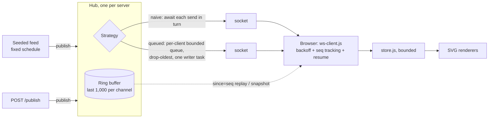

# websocket-live

> A WebSocket push server and live dashboard, built to measure one failure: what a client that
> stops reading does to everyone else.

[](https://github.com/Prithv122/websocket-live/actions/workflows/ci.yml)

**Live demo:** not deployed; runs locally (one command, below).
**Stack:** Python 3.13 · FastAPI/Starlette WebSockets on uvicorn · `websockets` · vanilla JavaScript
(ES modules, hand-built SVG, no framework, no chart library, no build step).

---

## 1. The problem

Operations teams watch orders, queues and sensors on dashboards that should update the moment a
number changes. Polling every second costs a request per viewer per second whether anything
changed or not; pushing over WebSockets fixes that, but introduces a quieter failure. If one
viewer's tab freezes or its network stalls, the server's send to that socket eventually blocks,
and a broadcast loop that awaits each send in turn makes **every** viewer wait behind it.

This project builds the push path end to end and measures exactly that: with a share of clients
that never read, do the healthy clients still get their updates on time?

## 2. The data

| | |
|---|---|
| Source | A seeded generator of delivery-order events (`OrderEvent`: order id, zone, amount, status) |
| Size | 20 events per second for as long as the server runs; tests use a fixed 60-event fixture |
| Licence | Generated in this repository (MIT) |
| Refresh | Live |

All data is synthetic. **Every number below is a property of this simulator on one laptop, not of a
production system.**

## 3. Architecture



- **Wire format** (`PROTOCOL.md`): every message is an envelope
  `{v, channel, seq, ts, type, data}`. `seq` is per channel and gap-free, so a client can tell
  when it missed something. Types: `event`, `heartbeat`, `snapshot`, `gap`.
- **Resume:** a reconnecting client sends `?since=<last seq>`. Inside the ring buffer the server
  replays the missed events; older than the ring it sends one snapshot. No hole, no duplicate at
  the replay/live boundary (tested with publishes racing the replay).
- **Slow consumers:** under `queued`, a full queue drops its oldest message and the writer sends a
  `gap` envelope (`seq = b`, `data = {from: a, to: b}`), so the client's stream stays continuous
  and it knows exactly what it lost.
- **Browser client:** reconnects with exponential backoff and full jitter, resumes from its last
  seq, ignores unknown message types, and redraws at most once per animation frame.

## 4. Key decisions & tradeoffs

| Decision | Chose | Over | Why |
|---|---|---|---|
| Fan-out | Own `Hub` on raw Starlette WebSockets | `python-socketio`, Redis pub/sub | The fan-out and slow-consumer logic is the thing under test; a library would hide it, and Redis adds a service without changing the per-socket problem |
| Slow-consumer policy | Bounded queue per client, drop **oldest** | Unbounded queue; drop newest; disconnect | Unbounded queues turn one stalled tab into server memory growth. For a live dashboard the newest value matters most, and a `gap` message tells the client what it lost |
| Latency clock | Receive time minus **scheduled** publish time | Minus the server's `ts` stamp | A publisher blocked behind a stalled socket stamps late; stamp-based latency hides the very delay being measured (coordinated omission). Stamp latency is kept as a secondary column |
| Stalled client | Raw TCP socket that completes the handshake and never reads | A library client that doesn't call `recv()` | Library clients keep draining the socket into their own queue, which hides the stall from the server |
| WebSocket implementation | `websockets-sansio`, pinned | uvicorn's `auto` | `naive` only blocks if `send` waits for the socket to drain; pinning stops a silent change of what is measured. uvicorn's 20 s ping is disabled, or it would disconnect stalled clients mid-run |
| Resume | Ring buffer of 1,000 + `since=` | Snapshot on every reconnect | About forty lines, and the streaming-pipeline project that publishes into this dashboard gets lossless reconnects |
| Thresholds | Pre-registered in `EVAL_PLAN.md` before any run | Choosing after seeing results | The verdict is computed by `wslive report`, not by hand; a null result is published as a null |

## 5. Results

**Pre-registered question** (`EVAL_PLAN.md`, committed before any timing run): at N = 200 clients
with 10% stalled, does `queued` keep the healthy clients' p95 latency (from scheduled time) at or
under **100 ms** with at least 99% delivered, where `naive` does not?

**Verdict, computed by `wslive report`: SUPPORTED UNDER ESCALATION.** At the default message size
both arms passed. With 4 KB messages (step 1 of the pre-registered escalation ladder) `naive` froze
completely and `queued` was unaffected. 60 runs, none invalid. Source: [`results/REPORT.md`](results/REPORT.md),
generated from `results/sweep.jsonl`.

| Stage | Arm | p95 latency, median of 3 (range) | Delivered | Result |
|---|---|---|---|---|
| default messages (~190 B) | `naive` | 21.4 ms (18.6–22.4) | 100% | pass |
| default messages | `queued` | 24.0 ms (22.8–24.9) | 100% | pass |
| 4 KB messages | `naive` | ∞ | **0%** | **fail** |
| 4 KB messages | `queued` | 23.6 ms (23.2–24.2) | 100% | pass |

- **What "0%" means.** In every `naive` run at 4 KB, not one healthy client received a single event
  in the 60-second window: the publisher's `await send()` to a stalled socket blocked before the
  window opened and never returned, so all 180 healthy clients waited behind 20 frozen ones. The
  server kept answering only with heartbeats. The second ladder step (a 4 KB receive buffer on the
  stalled clients) was not needed and not run.
- **Why the small-message runs passed.** At 20 events/s of about 190 bytes, the kernel and server
  send buffers in front of a stalled socket did not fill within one 65-second run, so `naive` never
  had to wait. The failure was there, only slower than the run; at 4 KB the same buffers filled
  during the 3-second warm-up. The ladder was written before any run for exactly this case.
- **`queued` costs a few milliseconds when nothing is wrong.** With no stalled clients its p95 was
  higher than `naive`'s at every size (N = 200: 24.6 vs 20.4 ms; N = 500: 38.6 vs 30.6 ms): the
  extra queue hop and one writer task per client. That is the price of the insurance.
- **Full matrix** (N = 50 / 200 / 500, 0 / 10 / 30% stalled, small messages): every cell delivered
  100% with zero gaps in both arms; the worst median p95 was 38.6 ms (`queued`, N = 500, no stalls).
  One `queued` run at N = 500 with 30% stalled had a p95 of 365.9 ms against 35.8–36.2 ms for its
  repeats; the median ignores it, and the report lists it in the range.
- **Validity.** No run was invalid: every load-generator worker's loop-lag p99 stayed under the
  20 ms limit, and every intended stalled and healthy client connected. The margin was thin (the
  highest was 19.9 ms), mostly Windows timer granularity, which puts an idle floor of about 15 ms
  under a 10 ms ticker (see `EVAL_PLAN.md`).
- **Push vs 1 s polling** (descriptive, one run each, N = 200, `results/push_vs_poll/`): the same
  bytes (about 780 KB/s from the server, because at 20 events/s every poll has news) but 200 HTTP
  requests per second, and a p50 latency of 502 ms instead of 13 ms. Polling's byte cost would show
  at low event rates, which were not measured.

All numbers come from one laptop (Intel i7-8850H, Windows 11) running both the server and the load
generator; they describe this simulator, not a production system.

## 6. How to run

Prerequisites: Python 3.13 with [uv](https://docs.astral.sh/uv/), Node 22+ (only for the client tests).

```bash
git clone https://github.com/Prithv122/websocket-live.git
cd websocket-live
uv sync
uv run wslive serve --strategy queued --feed-rate 20
```

Open <http://127.0.0.1:8000> for the dashboard. Kill and restart the server to watch it reconnect.

```bash
uv run python -m pytest                    # server, hub, protocol, benchmark maths (real sockets included)
npm ci; npm test; npm run validate         # browser client and HTML
uv run wslive bench --n 3 --stalled 1 --seconds 3   # 3-second smoke, prints a results path
uv run wslive sweep; uv run wslive report  # the pre-registered matrix (about 70 minutes, quiet machine)
```

`POST /publish/{channel}` is open by default for local use. Set `PUBLISH_TOKEN` in the
environment to require `Authorization: Bearer <token>`.

<http://127.0.0.1:8000/?channel=windows> shows the windowed aggregates that the
[streaming-pipeline](https://github.com/Prithv122/streaming-pipeline) bridge publishes: the newest
revision of each zone window, marked provisional or final. Open it before the bridge runs; a new
client gets live events only.

## 7. What I'd change at 100× scale

- **One process, one core.** Every JSON encode and socket write runs on one event loop. Encode
  each envelope once per publish (already done) and move fan-out to several worker processes,
  each owning a slice of the sockets behind a load balancer with sticky connections.
- **State lives in memory.** The ring buffer and sequence counters die with the process, which
  the epoch heartbeat makes visible but does not prevent. At scale the log moves to a durable
  stream (Redis Streams, Kafka or Redpanda, as in the streaming-pipeline project), and `seq`
  becomes the stream offset, so any worker can serve `since=` replays.
- **Fan-out cost grows with viewers × rate.** Coalesce updates per client (send the latest state
  per zone at most every N ms instead of every event); a dashboard doesn't need every tick.
- **Slow consumers at scale.** Keep the bounded drop-oldest queue and add an eviction rule (a
  client that has dropped messages for more than a set time is closed and reconnects with
  `since=`), so a permanently dead socket does not hold a writer task forever.
- **Measurement.** The load generator would move to separate machines, with clock sync, since one
  laptop running both sides is the first thing that breaks in this benchmark.

---

## References

- Gil Tene, "How NOT to Measure Latency" (coordinated omission).
- RFC 6455, The WebSocket Protocol.
