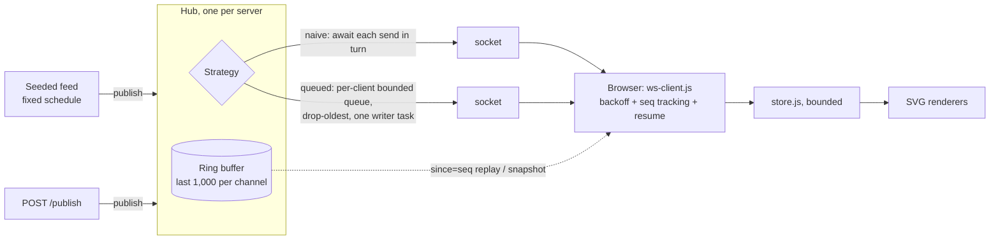

# websocket-live

> A WebSocket push server and live dashboard, built to measure one failure: what a client that
> stops reading does to everyone else.

[](https://github.com/Prithv122/websocket-live/actions/workflows/ci.yml)

**Live demo:** not deployed; runs locally (one command, below).
**Stack:** Python 3.13 · FastAPI/Starlette WebSockets on uvicorn · `websockets` · vanilla JavaScript
(ES modules, hand-built SVG, no framework, no chart library, no build step).

---

## 1. The problem

Operations teams watch orders, queues and sensors on dashboards that should update the moment a
number changes. Polling every second costs a request per viewer per second whether anything
changed or not; pushing over WebSockets fixes that, but introduces a quieter failure. If one
viewer's tab freezes or its network stalls, the server's send to that socket eventually blocks,
and a broadcast loop that awaits each send in turn makes **every** viewer wait behind it.

This project builds the push path end to end and measures exactly that: with a share of clients
that never read, do the healthy clients still get their updates on time?

## 2. The data

| | |
|---|---|
| Source | A seeded generator of delivery-order events (`OrderEvent`: order id, zone, amount, status) |
| Size | 20 events per second for as long as the server runs; tests use a fixed 60-event fixture |
| Licence | Generated in this repository (MIT) |
| Refresh | Live |

All data is synthetic. **Every number below is a property of this simulator on one laptop, not of a
production system.**

## 3. Architecture



- **Wire format** (`PROTOCOL.md`): every message is an envelope
  `{v, channel, seq, ts, type, data}`. `seq` is per channel and gap-free, so a client can tell
  when it missed something. Types: `event`, `heartbeat`, `snapshot`, `gap`.
- **Resume:** a reconnecting client sends `?since=<last seq>`. Inside the ring buffer the server
  replays the missed events; older than the ring it sends one snapshot. No hole, no duplicate at
  the replay/live boundary (tested with publishes racing the replay).
- **Slow consumers:** under `queued`, a full queue drops its oldest message and the writer sends a
  `gap` envelope (`seq = b`, `data = {from: a, to: b}`), so the client's stream stays continuous
  and it knows exactly what it lost.
- **Browser client:** reconnects with exponential backoff and full jitter, resumes from its last
  seq, ignores unknown message types, and redraws at most once per animation frame.

## 4. Key decisions & tradeoffs

| Decision | Chose | Over | Why |
|---|---|---|---|
| Fan-out | Own `Hub` on raw Starlette WebSockets | `python-socketio`, Redis pub/sub | The fan-out and slow-consumer logic is the thing under test; a library would hide it, and Redis adds a service without changing the per-socket problem |
| Slow-consumer policy | Bounded queue per client, drop **oldest** | Unbounded queue; drop newest; disconnect | Unbounded queues turn one stalled tab into server memory growth. For a live dashboard the newest value matters most, and a `gap` message tells the client what it lost |
| Latency clock | Receive time minus **scheduled** publish time | Minus the server's `ts` stamp | A publisher blocked behind a stalled socket stamps late; stamp-based latency hides the very delay being measured (coordinated omission). Stamp latency is kept as a secondary column |
| Stalled client | Raw TCP socket that completes the handshake and never reads | A library client that doesn't call `recv()` | Library clients keep draining the socket into their own queue, which hides the stall from the server |
| WebSocket implementation | `websockets-sansio`, pinned | uvicorn's `auto` | `naive` only blocks if `send` waits for the socket to drain; pinning stops a silent change of what is measured. uvicorn's 20 s ping is disabled, or it would disconnect stalled clients mid-run |
| Resume | Ring buffer of 1,000 + `since=` | Snapshot on every reconnect | About forty lines, and the streaming-pipeline project that publishes into this dashboard gets lossless reconnects |
| Thresholds | Pre-registered in `EVAL_PLAN.md` before any run | Choosing after seeing results | The verdict is computed by `wslive report`, not by hand; a null result is published as a null |

## 5. Results

**Pre-registered question** (`EVAL_PLAN.md`, committed before any timing run): at N = 200 clients
with 10% stalled, does `queued` keep the healthy clients' p95 latency (from scheduled time) at or
under **100 ms** with at least 99% delivered, where `naive` does not?

| Arm | p95 latency, median of 3 (range) | Delivered | Verdict |
|---|---|---|---|
| `naive` | TBD (run `wslive sweep`) | TBD | TBD |
| `queued` | TBD | TBD | TBD |

_Full matrix (N = 50 / 200 / 500, 0 / 10 / 30% stalled) and push-vs-poll traffic: TBD, from
`results/REPORT.md`._

## 6. How to run

Prerequisites: Python 3.13 with [uv](https://docs.astral.sh/uv/), Node 22+ (only for the client tests).

```bash
git clone https://github.com/Prithv122/websocket-live.git
cd websocket-live
uv sync
uv run wslive serve --strategy queued --feed-rate 20
```

Open <http://127.0.0.1:8000> for the dashboard. Kill and restart the server to watch it reconnect.

```bash
uv run python -m pytest                    # server, hub, protocol, benchmark maths (real sockets included)
npm ci; npm test; npm run validate         # browser client and HTML
uv run wslive bench --n 3 --stalled 1 --seconds 3   # 3-second smoke, prints a results path
uv run wslive sweep; uv run wslive report  # the pre-registered matrix (about 70 minutes, quiet machine)
```

`POST /publish/{channel}` is open by default for local use. Set `PUBLISH_TOKEN` in the
environment to require `Authorization: Bearer <token>`.

## 7. What I'd change at 100× scale

TBD after the sweep: where this one process saturates first, and what replaces it.

---

## References

- Gil Tene, "How NOT to Measure Latency" (coordinated omission).
- RFC 6455, The WebSocket Protocol.
